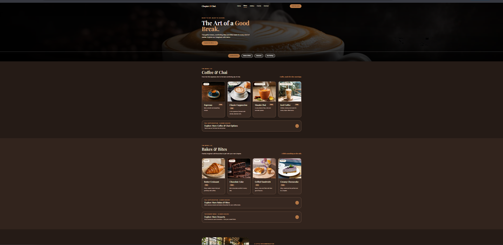
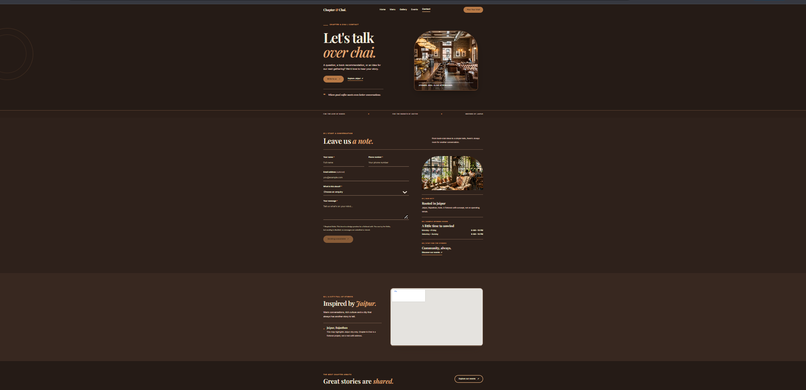

# Chapter & Chai

**A cozy book café experience, inspired by Jaipur.**

[**View Live Website**](https://chapter-and-chai.vercel.app/) · [**Explore the Menu**](https://chapter-and-chai.vercel.app/menu.html)

## About the project

Chapter & Chai is a fictional book café website based in Jaipur. I created it for my **Milestone 1 project** to practice HTML, Tailwind CSS, and responsive web design.

The idea was to build a cozy café website where visitors can explore the menu, see the café's atmosphere, and learn about book-related events.

## Pages

| Page | What you'll find |
| --- | --- |
| [Home](https://chapter-and-chai.vercel.app/) | Café introduction, menu highlights, reasons to visit, and customer testimonials |
| [Menu](https://chapter-and-chai.vercel.app/menu.html) | Coffee, chai, snacks, and desserts with prices |
| [Gallery](https://chapter-and-chai.vercel.app/gallery.html) | Café atmosphere, reading spaces, and food photography |
| [Events](https://chapter-and-chai.vercel.app/events.html) | Book club, poetry/open mic, and writing workshop details |
| [Contact](https://chapter-and-chai.vercel.app/contact.html) | Demo contact form, café information, and Jaipur map |

## Technologies used

- **HTML5** for semantic page structure
- **Tailwind CSS (CDN)** for styling and responsive layouts
- **CSS Flexbox and Grid** for page layouts
- **Google Fonts:** Playfair Display and Inter

## Features

- Responsive layouts for mobile, tablet, and desktop
- Navigation across all five pages, including a mobile-friendly menu
- Light and dark mode styles based on device preferences
- Hover and focus effects
- Image and card layouts for menu items, gallery photos, and events
- Page-specific SEO and social sharing metadata
- Custom book-and-chai-themed SVG favicon

## Screenshots

### Home


### Menu


### Gallery


### Events


### Contact


## How to run locally

1. Download or clone this repository:
   ```bash
   git clone https://github.com/codewithsemm/chapter-and-chai.git
   ```
2. Open the project folder in VS Code.
3. Open `index.html` using **Live Server**, or open it directly in a browser.

No package installation or build step is required. An internet connection is needed to load Tailwind CSS and Google Fonts from their CDNs.

## Live website

**https://chapter-and-chai.vercel.app/**

Deployed on **Vercel**.

## Project note

This is a front-end project created for learning purposes. **Chapter & Chai is a fictional café.** The contact form is a design preview and does not send messages. The map represents Jaipur, not an actual café location.
