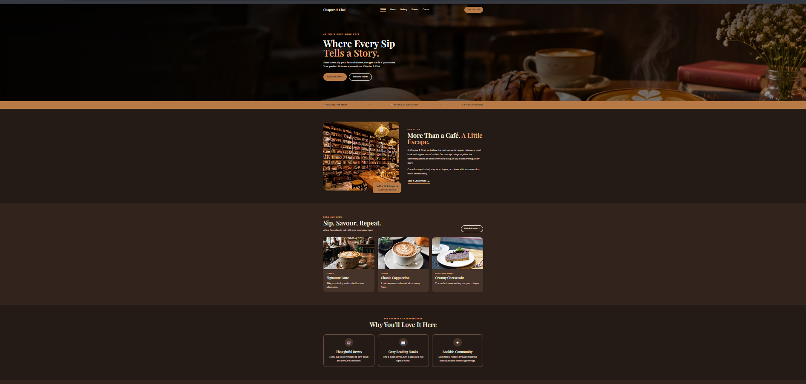

# Chapter & Chai

*A cozy book café website inspired by Jaipur.*

[Live Website](https://chapter-and-chai.vercel.app/) | [View Menu](https://chapter-and-chai.vercel.app/menu.html)

## About the project

Chapter & Chai is a fictional book café based in Jaipur. I made this website for my Milestone 1 project to practice HTML, Tailwind CSS, and responsive web design.

My idea was to create a place where people could enjoy coffee, read books, and spend some quiet time. I wanted the website to feel warm and simple, just like the café itself.

## Pages

| Page | What's on it |
| --- | --- |
| [Home](https://chapter-and-chai.vercel.app/) | Café introduction, highlights, why choose us, and testimonials |
| [Menu](https://chapter-and-chai.vercel.app/menu.html) | Coffee, chai, snacks, and desserts with prices |
| [Gallery](https://chapter-and-chai.vercel.app/gallery.html) | Photos of the café, reading spaces, and food |
| [Events](https://chapter-and-chai.vercel.app/events.html) | Book club, open mic, and writing workshop details |
| [Contact](https://chapter-and-chai.vercel.app/contact.html) | Contact form demo, café details, and Jaipur map |

## Technologies used

- HTML5 for the structure of the pages
- Tailwind CSS (CDN) for styling and responsive design
- CSS Flexbox and Grid for different layouts
- A little JavaScript for the contact form demo
- Google Fonts: Playfair Display and Inter
- Git and GitHub for version control
- Vercel for deployment

## Features

- Five pages with the same navigation and design style
- Responsive layouts for mobile, tablet, and desktop
- Mobile navigation menu
- Light and dark mode based on device settings
- Hover and focus effects on buttons and links
- Menu cards, image gallery, and event sections
- Custom Chapter & Chai logo in the navbar and footer
- SVG favicon for the browser tab
- Basic SEO and social sharing information on each page
- Contact form demo with input validation and a confirmation message (no real message is sent)

## Screenshots

### Home


### Menu


### Gallery


### Events


### Contact


## How to run locally

1. Clone the repository:

   ```bash
   git clone https://github.com/codewithsemm/chapter-and-chai.git
   ```

2. Open the `chapter-and-chai` folder in VS Code.
3. Open `index.html` with Live Server, or open it in your browser.

There is no need to install any packages. Internet access is needed for Tailwind CSS and Google Fonts because they are loaded from CDNs.

## GitHub and deployment

I used Git branches and pull requests while working on the website. I also made a separate `feature/logo-integration` branch to add the café logo to all pages, then merged it into `main`.

The website is deployed on Vercel:

https://chapter-and-chai.vercel.app/

## What I learned

This project helped me understand how to build a complete multi-page website instead of just practicing individual sections. I got more practice with responsive layouts, choosing between Grid and Flexbox, keeping the design consistent, and using GitHub to manage changes.

I also learned that small things like image paths, mobile spacing, and navigation behavior matter when putting a website together.

## Project note

Chapter & Chai is a fictional café made for learning purposes. The contact form is a front-end demo, so it does not send or store messages. The map shows Jaipur and is not an actual café location.
