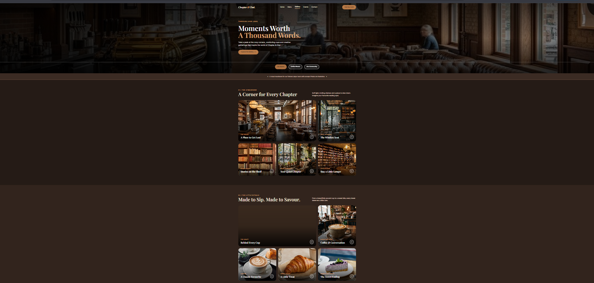
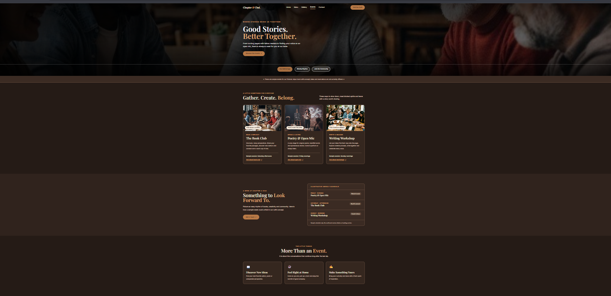

# Chapter & Chai ☕📚

*A cozy, responsive book café website inspired by Jaipur.*

[**Live Website**](https://chapter-and-chai.vercel.app/) · [**GitHub Repository**](https://github.com/codewithsemm/chapter-and-chai) · [**Explore the Menu**](https://chapter-and-chai.vercel.app/menu.html)

## About the Project

Chapter & Chai is a fictional book café concept created for my **Milestone 1 frontend project**. The idea is to bring together coffee, books, conversations, and community events in one warm and welcoming space.

I built a complete **six-page responsive website** to practice semantic HTML5, Tailwind CSS, custom CSS, responsive layouts, and Git/GitHub workflows. The design uses warm café-inspired colors, readable typography, original branding, and subtle CSS animations.

## Website Pages

| Page | Description |
| --- | --- |
| [Home](https://chapter-and-chai.vercel.app/) | Café introduction, highlights, featured offerings, reasons to visit, and testimonials. |
| [Menu](https://chapter-and-chai.vercel.app/menu.html) | Coffee, chai, bakes, bites, and other menu items presented in responsive layouts. |
| [Gallery](https://chapter-and-chai.vercel.app/gallery.html) | A visual tour of the café atmosphere, reading corners, drinks, and food. |
| [Events](https://chapter-and-chai.vercel.app/events.html) | Book club, workshops, and community event information. |
| [About Us](https://chapter-and-chai.vercel.app/about.html) | The café concept, its story, values, and community-focused experience. |
| [Contact](https://chapter-and-chai.vercel.app/contact.html) | Contact details, a demonstration contact form, and an embedded Jaipur map. |

## Technologies Used

- **HTML5** — page structure, semantic elements, links, and native form validation.
- **Tailwind CSS (Play CDN)** — utility-first styling, spacing, breakpoints, and responsive layouts.
- **Custom CSS** — animations, transitions, visual refinements, and interactive states.
- **CSS Grid and Flexbox** — multi-column content layouts and one-dimensional alignment.
- **Google Fonts** — Playfair Display and Inter.
- **Git & GitHub** — version control and project history.
- **Vercel** — website deployment.

> **JavaScript clarification:** I did **not write custom JavaScript** for the website. The mobile menu uses native HTML `<details>` / `<summary>`, and the visual animations use CSS. However, Tailwind's Play CDN is loaded through a `<script>` and runs JavaScript in the browser to generate styles. This project is therefore *custom-JavaScript-free*, not strictly JavaScript-free.

## Main Features

- Six connected pages with consistent navigation, branding, and footer.
- Responsive layouts for mobile, tablet, and desktop screens.
- Mobile hamburger navigation built with native HTML and CSS, without custom JavaScript.
- Responsive card and image layouts using **Grid**, with **Flexbox** for navigation and alignment.
- Slow hero-image zoom, staggered content entrances, hover effects, and smooth transitions using CSS.
- Reduced-motion considerations for visitors who prefer less animation.
- Light/dark styling using Tailwind's dark-mode variants and device preferences.
- Custom Chapter & Chai branding, SVG favicon, and Google Fonts.
- Basic SEO metadata and social-sharing information.
- Accessible touches such as semantic sections, image alternative text, labels, and focus-visible states.
- Contact form with browser-native validation and a CSS-based demonstration confirmation.

### Contact Form — Demo Only

The contact page uses HTML fields such as `<input>`, `<select>`, and `<textarea>` with attributes including `required`, input types, and length limits. After a valid demo submission, an on-page confirmation can be displayed using the URL fragment and CSS `:target`.

**No backend is connected.** The form does not email, send, or store submitted messages. It is a frontend demonstration, not a working contact service.

## Responsive Layout Decisions

**CSS Grid** is used for collections such as menu cards, where items need to be arranged into rows and columns. Responsive Tailwind breakpoints change the number of columns depending on screen width.

**Flexbox** is used where elements need to align along one main direction, such as navigation, buttons, and content rows.

At narrow mobile widths, content can stack into fewer columns, and the desktop navigation is replaced by a mobile-friendly menu. These layouts can be demonstrated by resizing the browser or using Chrome DevTools device mode.

## Screenshots

The screenshot paths below are retained from the earlier README. They will display on GitHub when the corresponding image files are present in the repository.

### Home


### Menu


### Gallery


### Events


### Contact


## Run Locally

1. Clone the repository:

   ```bash
   git clone https://github.com/codewithsemm/chapter-and-chai.git
   ```

2. Open the `chapter-and-chai` folder in **VS Code**.
3. Open `index.html` with the **Live Server** extension, or open the file in your browser.
4. Use the navigation to explore the other pages.

No npm installation or build command is required for this version. **Internet access is required** to load Tailwind's Play CDN and Google Fonts.

## GitHub & Deployment

- **Repository:** https://github.com/codewithsemm/chapter-and-chai
- **Live site:** https://chapter-and-chai.vercel.app/
- **Main branch:** `main`
- **Latest confirmed project commit:** `837563f` — `Complete About Us page and improve CSS animations`

During development, I used Git to track changes. The earlier project history also records a `feature/logo-integration` branch for adding the café logo across pages, which was merged into `main`. The repository's **Commits**, **Branches**, and **Pull requests** tabs provide the version-control history for the live presentation.

## What I Learned

Building Chapter & Chai helped me practice turning individual HTML/CSS exercises into a complete multi-page website. In particular, I learned how to:

- Choose **Grid vs Flexbox** based on the layout requirement.
- Use semantic elements like `<header>`, `<nav>`, `<main>`, `<section>`, `<article>`, and `<footer>` appropriately.
- Create responsive interfaces with Tailwind breakpoints and flexible sizing.
- Improve mobile navigation and visual interactions without writing custom JavaScript.
- Use HTML form validation and clearly separate a demo from real backend functionality.
- Maintain consistent colors, typography, assets, navigation, and styling across pages.
- Organize changes with Git and publish the site through GitHub and Vercel.

One challenge was keeping the layout consistent at different viewport widths. I improved it by adjusting responsive breakpoints, container widths, and Grid/Flexbox arrangements, then checking the result at different screen sizes.

## Project Note

Chapter & Chai is a **fictional café made for learning and demonstration purposes**. The contact form does not transmit or store messages, and the embedded Jaipur map should not be interpreted as the location of a real Chapter & Chai business.

---

**Milestone 1 — Frontend Web Development Project**
